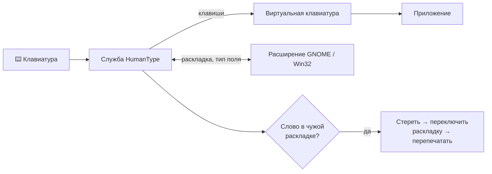

<div align="center">


<br>

[](https://github.com/Ms0Skrin/HumanType/actions/workflows/build.yml)
[](https://github.com/Ms0Skrin/HumanType/releases/latest)


**Пишешь — и не думаешь о раскладке.**<br>
Набрал `ghbdtn` и пробел — получилось `привет`, а раскладка сама стала русской. Пишешь дальше.


[Скачать для Windows](#-windows) · [Установить на Linux](#-linux) · [Горячие клавиши](#%EF%B8%8F-горячие-клавиши) · [Как это работает](#-как-это-работает)

</div>

---

## ✨ Возможности

| | |
|---|---|
| ⚡ **Исправляет на лету** | Пробел, Enter или Tab после слова в чужой раскладке — слово перепечатывается, раскладка переключается. Работает и для нескольких слов подряд: `z nt,z k.,k.` → `я тебя люблю`. |
| ↩️ **Отмена одной клавишей** | Backspace сразу после исправления возвращает слово как было и запоминает его — больше не тронет. |
| 🎯 **Умный словарь** | Частотные словари русского и английского, n-граммы, проверка коротких слов. Ссылки, имена файлов, команды и код не трогает. |
| 🔒 **Бережно к приватному** | Поля паролей, терминалы, редакторы кода, менеджеры паролей и игры на весь экран пропускаются. Текст никуда не отправляется. |
| 🧠 **Видит, что в поле** | На Linux сверяется с текстом перед курсором — автодополнение и вставки не ломают исправление. |
| 💻 **Ответы в терминале** | `н`, `нуы`, `т`, `тщ` по Enter становятся `y`, `yes`, `n`, `no` — не нужно переключать раскладку ради одного «yes». |

## ⌨️ Горячие клавиши

| Клавиши | Что делает |
|---|---|
| <kbd>Pause</kbd> | Перевернуть последнее слово в другую раскладку |
| <kbd>Shift</kbd> + <kbd>Pause</kbd> | Перевернуть всю набранную строку |
| <kbd>Alt</kbd> + <kbd>Pause</kbd> | Включить / выключить автопереключение |
| <kbd>Backspace</kbd> сразу после исправления | Отменить и запомнить слово |

## 🪟 Windows

Скачайте **HumanType-Setup.exe** со страницы [последнего релиза](https://github.com/Ms0Skrin/HumanType/releases/latest) и запустите.
Права администратора не нужны: программа ставится для текущего пользователя и запускается вместе с Windows. Значок появится в трее.

## 🐧 Linux

Сейчас поддерживается **GNOME на Wayland** (GNOME 46–51): Arch / CachyOS, Fedora, Ubuntu 24.04+ и другие.

```bash
# зависимости — Arch / CachyOS
sudo pacman -S --needed git python-evdev python-gobject
# Fedora:  sudo dnf install git python3-evdev python3-gobject
# Ubuntu:  sudo apt install git python3-evdev python3-gi

git clone https://github.com/Ms0Skrin/HumanType.git ~/.local/share/humantype-app
~/.local/share/humantype-app/linux/install.sh
```

Установщик один раз спросит пароль sudo, поставит расширение GNOME, пункт в меню приложений и службу, которая стартует при входе.
**Затем выйдите из сеанса и войдите снова** — GNOME загружает новые расширения только при входе. Значок HumanType появится справа вверху.

<details>
<summary><b>Обновить, удалить, посмотреть журнал</b></summary>

```bash
# обновить
git -C ~/.local/share/humantype-app pull && ~/.local/share/humantype-app/linux/install.sh
# удалить
~/.local/share/humantype-app/linux/install.sh --uninstall
# журнал службы
journalctl --user -u humantype -f
# настройки
~/.config/humantype/settings.json      # и exceptions.txt — слова, которые не трогать
```

</details>

## 🔍 Как это работает



- **Windows:** низкоуровневый хук клавиатуры, ввод через `SendInput`, поля паролей распознаются через MSAA.
- **Linux:** служба читает клавиатуру через `evdev` и передаёт клавиши дальше через виртуальную клавиатуру `uinput`. Расширение GNOME Shell сообщает раскладку, тип поля и совпадает ли текст перед курсором с набранным — сам текст наружу не отдаётся.
- Если служба зависнет, через 3 секунды она отпускает клавиатуру и перезапускается.

> [!NOTE]
> На Linux установщик добавляет правило udev, которое даёт программам вашего сеанса право читать клавиатуру. На Wayland без этого программа автопереключения невозможна.

## 🧪 Тесты

```bash
python tests/linux_engine.py     # движок Linux, без устройств
python tests/linux_e2e.py        # живой GNOME: виртуальная клавиатура печатает в тестовое окно
python tests/sim_autoswitch.py   # логика Windows-версии с заглушками Win32
```

Тесты прогоняются в [GitHub Actions](https://github.com/Ms0Skrin/HumanType/actions) на каждый push; на тег `v*` собирается установщик для Windows и публикуется релиз.

<details>
<summary><b>Собрать Windows-версию самому</b></summary>

Нужны Python 3.12+, `pip install pyside6 pywin32 pyinstaller` и [Inno Setup 6](https://jrsoftware.org/isdl.php).
Запустите `build.bat` — получится `installer\HumanType-Setup-<версия>.exe`.

</details>

<div align="center">
<br>
<sub>Сделано с ❤️ для тех, кто пишет на двух языках</sub>
</div>
